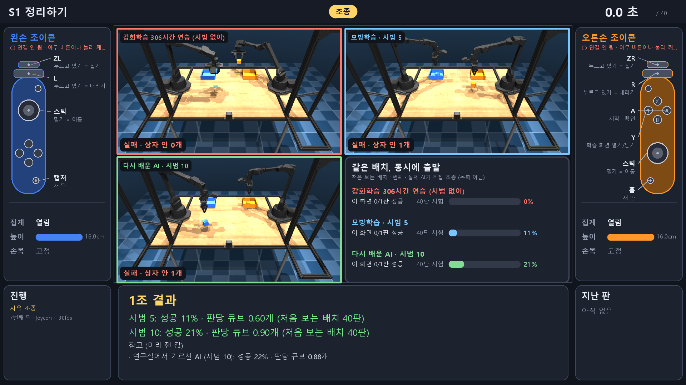
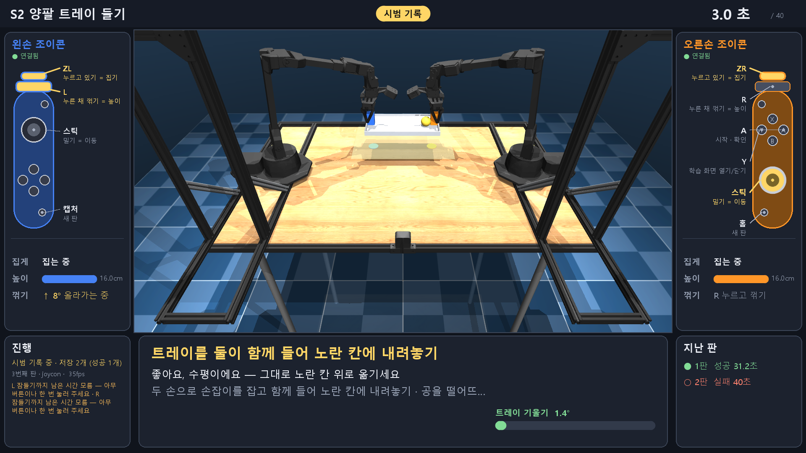

# Teach-a-Bot Lab

고등학생 연구실 견학용 데모입니다. 학생이 Joy-Con으로 시뮬레이션 속 양팔 로봇(ALOHA 2)을 조종해 시범을 보이면, AI가 그 시범으로 모방학습을 하고 처음 보는 배치에서 시험을 봅니다. 같은 과제를 강화학습으로만 배운 AI와 나란히 비교합니다. 화면의 숫자는 모두 실제 학습과 시험 결과입니다.



## 무엇을 하나

- **조종**: Joy-Con 스틱으로 이동, ZL/ZR로 집기, L/R로 높이, 조이콘 기울기로 손목. 키보드로도 됩니다.
- **모방학습**: 시범을 손별 작은 신경망(입력 18 → 256 → 256 → 출력 6)으로 1분 안에 학습하고, 처음 보는 배치 40판으로 시험합니다.
- **넘겨받기**: AI가 멈추면 학생이 그 손을 넘겨받아 마무리하고, 고친 부분만 다시 학습합니다.
- **강화학습 기준선**: 같은 과제를 PPO로 수백 시간 연습시킨 체크포인트와 비교합니다.
- **견학 모드**: AI 구경 → 연습 → 시범 → 공부 → 비교 → AI 시연 → 다시 공부 → 비교 → 결과. 순서와 키는 `docs/VISIT_RUNBOOK.md`에 있습니다.

## 측정 결과

S1 과제(두 큐브를 같은 색 상자에 넣기)를 학습 때 쓰지 않은 배치에서 시험한 결과입니다.

| AI | 성공률 | 시험 | 다시 재는 명령 |
|---|---|---|---|
| 강화학습 PPO, 성공해야만 점수, 972시간 연습 | 0% | 40판 | `scripts\monitor_rl.py --once` |
| 강화학습 PPO, 단계별 점수, 306시간 연습 | 0% (판당 큐브 0.03개) | 40판 | `scripts\monitor_rl.py --once` |
| 모방학습, 시범 10개 | 25% | 40판 | `scripts\train_bc.py --curve 1 2 3 5 10` |
| 모방학습, 시범 10개 + 넘겨받기 10판 | 36.7% | 100판 × 학습 3번 | `scripts\compare_datasets.py --seeds 0 1 2 --episodes 100` |

단계별 점수로 배운 강화학습 AI는 큐브를 잡아 들지만 끝까지 놓지 않습니다. 놓으면 점수가 사라지기 때문입니다. 경위는 `docs/DECISIONS.md`와 `docs/PROGRESS.md`에 있습니다.

## 필요한 것

- Windows 10 또는 11. Joy-Con 연결이 Windows Bluetooth API(`winrt`)를 씁니다.
- [uv](https://docs.astral.sh/uv/)와 Python 3.12. uv가 프로젝트 전용 `.venv`를 만듭니다.
- 글꼴: 맑은 고딕(Windows 기본).
- Joy-Con L/R(Switch 1). 없으면 `--input keyboard`로 실행합니다.

## 설치

1. 가상환경을 만들고 패키지를 설치합니다.

	```powershell
	uv venv --python 3.12 .venv
	uv pip install --python .venv\Scripts\python.exe -e ".[dev]"
	```

2. ALOHA 2 로봇 모델을 받습니다. MuJoCo Menagerie의 고정 커밋에서 파일 16MB를 받고 sha256을 확인합니다.

	```powershell
	.venv\Scripts\python.exe scripts\download_aloha.py
	```

3. 학습 데이터를 받습니다. 시범 데이터, 학습된 정책, 강화학습 306시간 체크포인트는 git이 아니라 릴리스 `data-v1`에 있습니다. 저장소 폴더에서 받아 풉니다.

	```powershell
	gh release download data-v1 --pattern "teachabot-data-v1.zip"
	Expand-Archive teachabot-data-v1.zip -DestinationPath .
	```

	풀면 `data\demos\s1`, `data\policies`, `data\rl_runs\dense_20261019_184623`이 생깁니다. 견학 모드의 시범 바탕(`--visit-base s01:5`)과 AI 구경·비교 화면이 이 데이터를 씁니다.

4. 설치를 확인합니다.

	```powershell
	.venv\Scripts\python.exe -m pytest -q
	```

## 실행

키보드로 바로 해 봅니다. WASD로 이동, Q로 집기, E로 내리기, Space로 시작합니다.

```powershell
.venv\Scripts\python.exe -m teachabot.aloha_app --input keyboard
```

Joy-Con으로 조종합니다. 먼저 아래의 연결 관리자를 켜 둡니다. 오른쪽 A로 시작합니다.

```powershell
.venv\Scripts\python.exe -m teachabot.aloha_app
```

견학 모드로 한 조를 진행합니다. 오른쪽 B를 1초 누르면 다음 단계로 넘어갑니다. **F**는 전체 화면입니다.

```powershell
.venv\Scripts\python.exe -m teachabot.aloha_app --visit 1조 --visit-demos 3 --visit-base s01:5 --video data\videos\visit_1조.mp4
```

S2 과제(둘이 함께 트레이를 들어 공을 나르기)를 조종합니다. L/R을 누른 채 손목을 꺾으면 높이가 바뀝니다.

```powershell
.venv\Scripts\python.exe -m teachabot.aloha_app --task s2
```



명령 전체는 `AGENTS.md`의 "명령" 절에 있습니다.

## 조이콘 연결 관리자 (더블클릭)

`JoyCon_Manager.bat`을 더블클릭하면 작은 창이 항상 위에 뜹니다. 앱보다 먼저 켜 두고 계속 둡니다. 앱과 함께 떠 있어도 충돌하지 않습니다.

- 손마다 **준비됨 / 잠듦 / 연결 중 / 고착 / 재페어링 / 페어링 필요**와 조이콘이 스스로 잠들기까지 남은 시간(마지막 버튼 입력 후 15분)을 보여 줍니다.
- 화면에 "SYNC 버튼을 누르세요"가 뜨면 조이콘 레일 옆 작은 SYNC 버튼을 한 번 누릅니다. Windows 설정 화면은 열지 않아도 됩니다.
- 고착(페어링됐는데 신호가 안 옴)은 자동으로 감지해 다시 페어링합니다. 남은 시간이 3분 이하이면 앱 화면에도 경고가 뜹니다. 아무 버튼이나 한 번 누릅니다.
- 처음 페어링한 L/R의 MAC 주소를 `config/joycon_link.json`에 저장하고, 그 뒤로는 그 조이콘만 받아들입니다. 이 파일은 PC마다 생기며 git에 올리지 않습니다. 다른 조이콘을 쓰려면 지웁니다.
- 끌 때는 창을 닫습니다. 기록은 `data/logs/link_manager_<시각>.log`, 설계 근거는 `docs/JOYCON_LINK_MANAGER_PLAN.md`에 있습니다.

## 다른 PC로 옮기기

`.venv`는 PC마다 다시 만듭니다. 복사해 온 `.venv`는 원래 PC의 파이썬을 가리킵니다. 위의 "설치"를 새 PC에서 다시 하고, 조이콘은 연결 관리자로 새로 페어링합니다. AI 에이전트가 설치를 대신할 때 따를 순서는 `docs/PORTING.md`에 있습니다.

## 문서

- `docs/PROJECT_CONTEXT.md`: 요구사항과 절대 규칙(성능 연출 금지, 실제 실행 없이 성공 보고 금지)
- `docs/PROGRESS.md`: 단계별로 무엇을 확인했는지
- `docs/DECISIONS.md`: 왜 이렇게 만들었는지(D1~D19)
- `docs/VISIT_RUNBOOK.md`: 견학 진행 순서와 키
- `docs/UI_REVIEW.md`: 화면 설계 검토
- `AGENTS.md`: 이 저장소에서 일하는 AI 에이전트의 규칙과 명령

## 라이선스

이 저장소의 코드와 문서는 MIT 라이선스입니다(`LICENSE`).

ALOHA 2 로봇 모델은 [MuJoCo Menagerie](https://github.com/google-deepmind/mujoco_menagerie)의 파일이며 BSD-3-Clause 라이선스입니다. 이 저장소에는 들어 있지 않고 `scripts/download_aloha.py`가 받습니다. 맑은 고딕 글꼴은 Windows에 들어 있는 것을 쓰며 저장소에 포함하지 않습니다.
