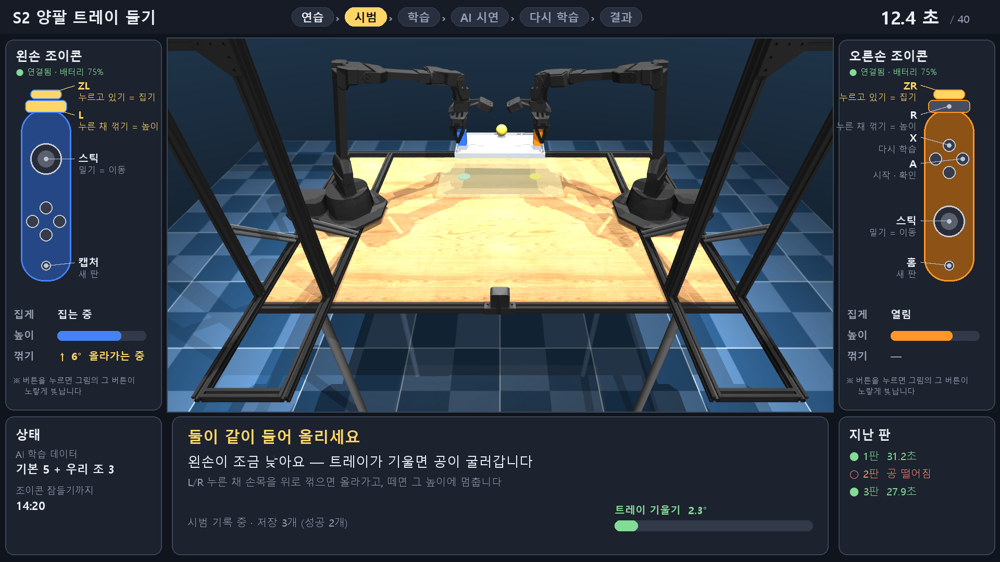
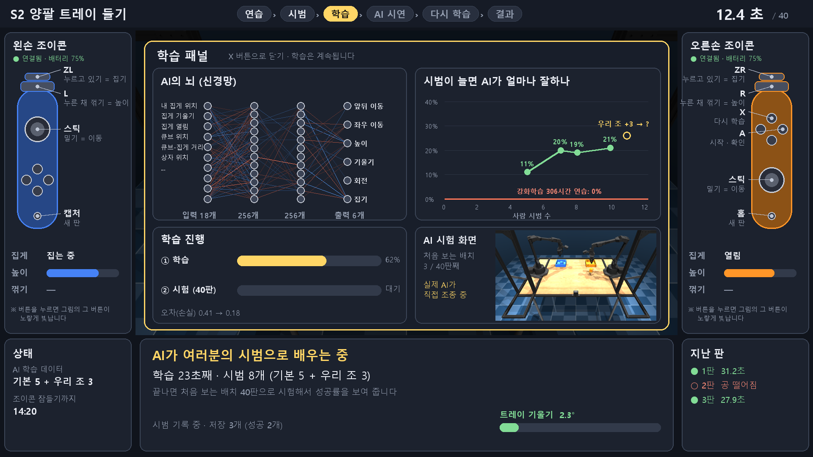

# 총괄 UI 개편 검토 (2026-10-20)

## 요청 (사용자)
> 글이 화면 밖을 넘어가고, 정신이 없어. 전체를 감싸는 wrapper GUI가 있고, 각각의 패널이 있고, 하나의 패널은 조이콘 모형이 있고 각각 선을 이어서 어떤 키인지 알려주고, 하나의 패널은 시뮬레이션 및 조종이 가능한 큰 화면이 있고, 학습 버튼을 누르면 또 작은 패널이 하나 나와서 학습 관련 신경망 그림이나 학습 그래프랑 자체 시뮬레이션 화면이 보이고 … 회의 및 검토해봐.

## 1. 지금 화면의 문제 (사용자 스크린샷 기준)
| # | 문제 | 원인 |
|---|---|---|
| 1 | 글이 화면 밖으로 넘어감 | 조이콘 잠들기 경고 줄이 양쪽 문장을 이어 붙여 1280px를 넘음 → **임시 수정함**(`6ef30de`: 작은 글씨, 그래도 길면 "…") |
| 2 | 정신이 없음 | 3D 장면 **위에** 글 상자 10여 개가 겹쳐 그려짐: 제목·부제·시간·기록 상태·트레이 기울기·시작 준비·경고 줄·손 상자 2개·조작 안내 줄 (견학 모드면 단계 띠·기록표 추가) |
| 3 | 조작법을 글로만 알려 줌 | 맨 아래 한 줄 "스틱: 이동 · L/R 누른 채 …"를 읽고 조이콘에서 그 버튼을 직접 찾아야 함 |
| 4 | 시작 준비 패널이 장면 가운데를 가림 | 모든 안내가 3D 화면 한가운데 오버레이 |
| 5 | 학습 단계는 "기다리는 화면" | 진행 글자뿐이라 AI가 무엇을 배우는지 보이지 않음 |
| 6 | 창이 1280×720 고정 | TV 전체 화면에서 글자 크기를 따로 맞출 수 없음 |

## 2. 회의: 관점별 검토
**견학 학생 (처음 보는 고교생, TV에서 2~3 m)**
- "어떤 버튼이 뭐예요?" → 조이콘 그림에서 버튼을 가리켜 주고, **누르면 그 버튼이 빛나야** 바로 연결된다.
- 한 번에 읽을 문장은 하나여야 한다. 지금은 화면 여러 곳에서 동시에 글이 바뀐다.
- 3D 장면은 가리지 말아야 한다. 공·트레이가 가장 중요한 정보다.

**진행자 (사용자, 혼자 진행)**
- 연결·배터리·잠들기 같은 상태는 학생이 아니라 진행자가 보는 정보다. 한쪽 구석에 고정된 자리가 있으면 된다.
- 지금 단계가 어디인지(연습→시범→학습→AI→다시 학습→결과)는 위쪽 한 줄로 늘 보여야 한다.
- 학습을 기다리는 1분이 가장 지루한 시간이다. 그 시간에 보여 줄 것(신경망, 그래프, AI 시험 화면)이 있으면 설명거리가 된다.

**교육 (무엇을 가르치나)**
- 핵심 메시지 "사람 시범 몇 개 → AI가 배움 → 처음 보는 배치에서 시험"을 그림으로 보여 준다.
- 비교 기준(강화학습 306시간 연습 0%)이 같은 그래프 안에 있어야 의미가 산다.
- 신경망 그림은 장식이 아니라 실제 가중치와 실제 입력·출력 이름으로 그린다. 연출은 쓰지 않는다(프로젝트 규칙).

**개발·안정성**
- 견학이 **내일(10/21)과 10/23**이다. 리허설하지 않은 새 화면으로 견학을 진행하는 것은 위험하다.
- 시뮬레이션·조종·기록·학습 로직은 그대로 두고 **화면 합성만** 바꾸는 것이 안전하다.
- 프레임 시간 실측(이 PC):
  - 1920×1080 화면에 반투명 상자와 글 40개를 매 프레임 새로 그리면 **33 ms**(p50)가 든다. 지금 프레임 26~29 ms 위에 그대로 더해지므로 쓸 수 없다.
  - 고정 패널은 한 번만 그려 두고 바뀌는 글자만 캐시해서 붙이면 **1.6 ms**(p50)다. 패널을 3D 화면 바깥(불투명)에 두면 반투명 합성도 필요 없다.

## 3. 제안 레이아웃 (1920×1080, 그림은 실제 장면으로 만든 시안)

| 구역 | 내용 |
|---|---|
| 위 띠 | 과제 이름 · 단계 칩(지금 단계만 노랑) · 시간 |
| 왼쪽 / 오른쪽 패널 | 왼손 / 오른손 조이콘 그림(직접 그린 단순 도형). 버튼마다 선을 이어 "버튼 이름 / 동작"을 표시하고, **누르는 버튼과 그 설명이 노랗게 빛난다**. 아래에는 그 손의 집게 상태, 높이 막대, 꺾기 각도 |
| 가운데 | 3D 시뮬레이션 1280×720. 위에 겹치는 글은 없다 |
| 아래 가운데 | **메시지 하나**(큰 제목 + 설명 한 줄). 우선순위는 연결 문제 > 멈춤·경고 > 단계 안내. 트레이 기울기 막대 |
| 아래 왼쪽 | 진행자 정보: AI 학습 데이터 수, 잠들기까지 남은 시간(경고 줄이 여기로 옮겨 와 넘칠 일이 없다) |
| 아래 오른쪽 | 지난 판 기록 |

학습 패널은 X(또는 학습 단계 진입)로 3D 화면 위에 열리고, 다시 X로 닫는다. 학습은 닫아도 계속된다.
- **AI의 뇌(신경망)**: 입력 18개 → 256 → 256 → 출력 6개. 선의 색과 밝기가 실제 가중치다(파랑 +, 빨강 −). 구현할 때는 학습 중 가중치가 바뀌는 모습을 몇 초마다 다시 그린다.
- **시범 수 → 성공률 그래프**: 측정 파일 값. 같은 그래프에 강화학습 306시간(0%) 기준선을 넣고, "우리 조 +3"의 결과 점은 학습과 시험이 끝나면 찍힌다.
- **학습 진행**: ① 학습 ② 시험(40판) 진행 막대와 오차(손실)가 줄어드는 곡선.
- **AI 시험 화면**: 방금 배운 정책이 처음 보는 배치를 **실제로 조종하는 판 하나**를 작게 보여 준다(녹화 재생 아님).

시안 속 값의 출처:
- **실제 값**
  - 3D 장면 2개: S2 트레이 장면, 시범 8개로 배운 정책이 S1을 조종하는 장면
  - 신경망 가중치: `bc_hand_base_s0_…_k8.npz`
  - 성공률 곡선(5→11%, 7→20%, 8→19%, 10→21%): `bc_curve_base_s0_….csv`
  - 강화학습 0%: 306시간 체크포인트의 40판 평가
- **예시 값**: 시간, 진행률, 손실 숫자, 배터리, 지난 판 기록, 입력 이름 일부

참고로 S2는 아직 조작·기록만 있어서, 학습 패널 시안의 데이터는 S1 것이다.

## 4. 기술 선택지
| 안 | 방법 | 장점 | 단점 | 10/23까지 |
|---|---|---|---|---|
| **A** | 지금처럼 OpenCV 창 + PIL. 1920×1080 캔버스에 패널 배치. 고정 패널과 글자 캐시 | 새 의존성 없음. 조종·학습·기록 코드 그대로. 실측 1.6 ms | 마우스로 누르는 버튼은 제한적(조이콘 버튼으로 조작). 애니메이션은 손으로 짜야 함 | **가능** |
| B | Dear PyGui (GPU 즉시 모드 GUI, 그래프 내장) | 빠름, 그래프·패널 쉬움, 의존성 작음 | 새 패키지 설치 필요(승인). 한글 폰트 글리프 범위 설정 필요. 처음 쓰는 도구 | 빠듯 |
| C | Qt (PySide6) | 진짜 창·패널·애니메이션, matplotlib 임베드 | 수백 MB 설치(승인), 구조 변경 큼 | 어려움 |
| D | 브라우저 UI + 로컬 서버(웹소켓으로 화면·상태 전송) | 디자인 자유도 최고. 나중에 만들 인터랙티브 슬라이드와 같은 기술 | 프로세스 2개, 영상 전송 지연, 의존성 추가 | 어려움 |

## 5. 권고
1. **10/21(내일)**: 지금 화면을 유지한다. 오늘 고친 것(글자 넘침, 손목 꺾기 높이)만 반영하고, 새 화면은 쓰지 않는다.
2. **10/23**: A안으로 구현한다.
   - 10/22에 리허설 1회를 하고, 통과하면 새 화면을 쓴다.
   - 안 되면 지금 화면으로 진행한다. `--ui classic`처럼 기존 화면을 옵션으로 남겨 둔다.
3. **이후**: 인터랙티브 슬라이드를 만들 때 D안(웹)을 다시 검토한다. 화면 구성(패널 배치, 조이콘 그림, 학습 패널)은 A안에서 검증된 것을 옮긴다.

## 6. A안 구현 단계 (추정)
| 단계 | 내용 | 시간 |
|---|---|---|
| 1 | 1920×1080 레이아웃 틀, 고정 패널 캐시, 지금 정보들을 각 구역으로 이동, `--ui classic` 유지 | 2~3 h |
| 2 | 조이콘 그림 + 실시간 버튼 하이라이트(입력 프레임의 버튼 상태 사용) | 1~2 h |
| 3 | 아래 메시지 영역: 우선순위 규칙과 한 번에 하나 | 1 h |
| 4 | 학습 패널. 손실 곡선은 `bc_hand` 로그 간격 조정이 필요(지금은 1000회마다 → 50회마다). 실제 가중치 신경망 그림, 시험 판 미니 화면(메인 프로세스에서 같은 정책으로 1판 실행), 성공률 그래프 | 3~4 h |
| 5 | 견학 흐름 연결, 프레임 시간 측정, 리허설 | 1~2 h |

합계 약 8~12시간이다. 10/22 리허설에 맞추려면 단계 1~3을 먼저 하고, 4(학습 패널)는 진행률·그래프부터 넣는다.

## 7. 결정할 것 (사용자)
1. 일정: 10/23에 새 화면을 쓸지, 견학 뒤로 미룰지
2. 기술: A안(지금 구조 확장)으로 갈지
3. TV 해상도: 1920×1080으로 가정함
4. 학습 패널 우선순위: 신경망 그림 / 성공률 그래프 / AI 시험 화면 중 무엇이 먼저인지
5. S2를 학습 흐름(시범→학습→AI)에 넣을지: 지금 S2는 조작·기록만 된다

## 8. 결정과 구현 (2026-10-20 밤)
사용자 결정은 "시안대로 바로 하자"였다. A안으로 구현해서 **기본 화면**으로 쓰고, 예전 화면은 `--ui classic`으로 남겼다.
- `src/teachabot/aloha_panels.py`
  - 바뀌지 않는 패널, 조이콘 그림, 설명선은 한 번만 그려 캐시한다. 캐시 키는 입력 장치, 높이 방식, 손목 사용 여부, 학습 유무다.
  - 매 프레임에는 바뀌는 값만 그린다.
- 조이콘 그림에는 누른 버튼과 그 설명이 노랗게 빛난다(입력 프레임의 버튼 상태 그대로). 키보드 입력이면 키 표로 바뀐다.
- 학습 화면(오른쪽 Y / 키보드 L, 학습을 시작하면 저절로 열림)
  - **신경망**: 실제 가중치로 그린다. 학습 중에는 250번마다 복사한 가중치로 다시 그린다.
  - **성공률 그래프**: 이번 조 기록과 참고 기준선(`config/visit_reference.json`)을 함께 그린다.
  - **배우기·시험 진행 막대와 오차 곡선**: 학습 50번마다 기록한다.
  - **AI 시험 화면**: 새 정책 파일이 저장되는 즉시 처음 보는 배치(시드 1,000,500~)에서 **실제로 조종**한다. 녹화를 재생하지 않는다.
- 학습 코드에 넣은 연결점(결과는 바뀌지 않음)
  - `train_hand_bc(progress=)`
  - `evaluate_policy(on_episode=)`: `pool.map`을 `imap`으로 바꿨고, 결과는 시드 순서 그대로다.
  - `LiveTrainer.progress / live_weights / pending_policy`
- S2: 메시지 칸이 시뮬레이션 상태를 보고 낮은 쪽 손을 알려 준다("왼손이 조금 낮아요"). 트레이 기울기 막대도 있다.
- 그리기 시간(이 PC, 창 없이)
  - 조종 화면: 13 ms(p50)
  - 학습 화면 + AI 시험 화면: 36~40 ms. 이때는 본 판이 멈춰 있다.

## 재현
- 시안 그림: 작업 중 만든 스크립트(실제 장면 렌더 + 실제 정책 가중치 + 측정 CSV). 확정되면 `scripts/`로 옮긴다.
- 프레임 시간 측정: 1920×1080, 상자·글 40개 매 프레임 그리기 33 ms vs 고정 패널 + 글자 캐시 1.6 ms (각 20~60회 p50).
